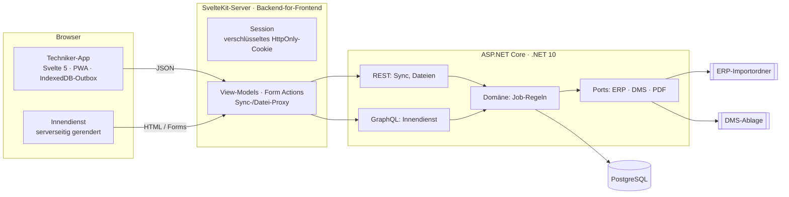

# Einsatz – Serviceberichte, auch ohne Netz

**Live-Demo: https://svelte.umut-aslan.dev** · Ein-Klick-Login als Techniker oder Innendienst

Techniker erfassen vor Ort Arbeitszeit, Material, Fotos und die Unterschrift des Kunden auf dem Tablet –
auch in der Halle ohne Empfang. Der Innendienst prüft den Bericht und gibt ihn frei: Der Beleg geht als
XML ins ERP, der unterschriebene PDF-Bericht wird im DMS abgelegt.

> Demo-Projekt mit frei erfundenen Firmen und Personen. Daten werden jede Nacht zurückgesetzt.

## Architektur: Frontend · Backend-for-Frontend · Backend



| Schicht | Aufgabe | Technik |
|---|---|---|
| **Frontend** | Techniker-App offline-first (Outbox in IndexedDB, Service Worker), Innendienst als SSR-Seiten | Svelte 5 (Runes), Tailwind 4 |
| **BFF** | Eigene Session (AES-256-GCM, HttpOnly, SameSite=Strict), hält das API-Credential serverseitig, baut View-Models, aggregiert Aufrufe, Form Actions mit CSRF-Schutz, CSP mit Script-Hashes | SvelteKit 2 auf Node |
| **Backend** | Geschäftsregeln, idempotente Sync-Befehle, GraphQL für flexible Abfragen, Integrationen hinter Ports, PDF-Erzeugung | C#, ASP.NET Core, EF Core, Hot Chocolate, QuestPDF |
| **Daten** | Relationales Modell, Migrationen, optimistische Nebenläufigkeit (`xmin`) | PostgreSQL 17 |

Nur der BFF ist öffentlich erreichbar. API, GraphQL-Schema und Datenbank liegen in einem internen
Docker-Netz – das prüft ein eigener End-to-End-Test.

Entscheidungen und ihre Begründung: [docs/adr](docs/adr).

## Was die Tests absichern

| Ebene | Anzahl | Beispiele |
|---|---|---|
| Domäne (xUnit) | 9 | Abschluss nur mit Unterschrift und gestoppter Zeit · abgeschlossene Berichte sind eingefroren · Rückgabe verlangt neue Unterschrift |
| API + PostgreSQL (xUnit) | 8 | erneut gesendeter Offline-Batch ändert nichts (Idempotenz) · abgelehnter Befehl blockiert den Rest nicht · Formular-POST wird abgewiesen (CSRF) · Techniker sieht nur eigene Aufträge · ERP-XML und PDF entstehen bei Freigabe · defektes Foto blockiert keine Freigabe |
| Web (Vitest) | 9 | lokaler Reducer spiegelt die Serverregeln · Session-Cookie ist manipulationssicher |
| End-to-End (Playwright) | 7 | **Bericht komplett offline erfassen, App offline neu laden, wieder online → automatisch synchronisiert → Innendienst gibt frei → ERP-Beleg enthält die Positionen** · API von außen nicht erreichbar · Innendienst funktioniert ohne JavaScript |

Die Backend-Tests laufen bewusst in der Zeitzone `Europe/Berlin`: Ein Fehler, den UTC-Testumgebungen
verschleiern, ist so aufgefallen (siehe ADR 0005).

## Lokal starten

Voraussetzung: nur Docker.

```bash
cp .env.example .env          # Passwörter setzen
./ops.sh test                 # alle Tests, isoliert vom Live-System
./ops.sh deploy               # Tests, dann Start hinter Traefik
```

## Demo-Zugänge

| Benutzer | Rolle | Passwort |
|---|---|---|
| jonas, lea | Techniker | demo |
| petra | Innendienst | demo |

---
Ein Projekt von [Umut Aslan](https://umut-aslan.dev) · [Wie KI bei diesem Projekt eingesetzt wurde](docs/AI-WORKFLOW.md)
